# Prompting semantic association

I've implemented a version of semantic association, where it is extracted by prompting a generative LLM and summarizing the probabilities over the range, as in the study by Brysbaert et al. (2024). I've used the gpt-4.1 model from OpenAI with the following prompt (strongly inspired by the prompt in the study by Brysbaert et al.):

```
Semantic association is a measure of how semantically associated or semantic related a context and a word is. For example, the words 'egg' and 'breakfast' are very semantically associated, and similarly are the context 'For breakfast the eggs would' and the word 'eat' semantically associated. Please indicate how semantically associated you think the following pair of context and word are on a scale from 1 (completely unassociated) to 7 (strongly associated). Only answer a number from 1 to 7. Please limit your answer to numbers.
```

## Semantic illusions

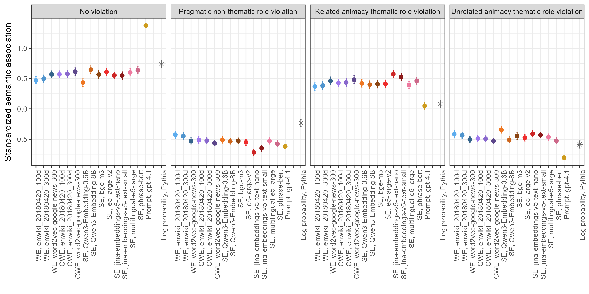
*Figure: Semantic Association, Kuperberg et al. (2007)*

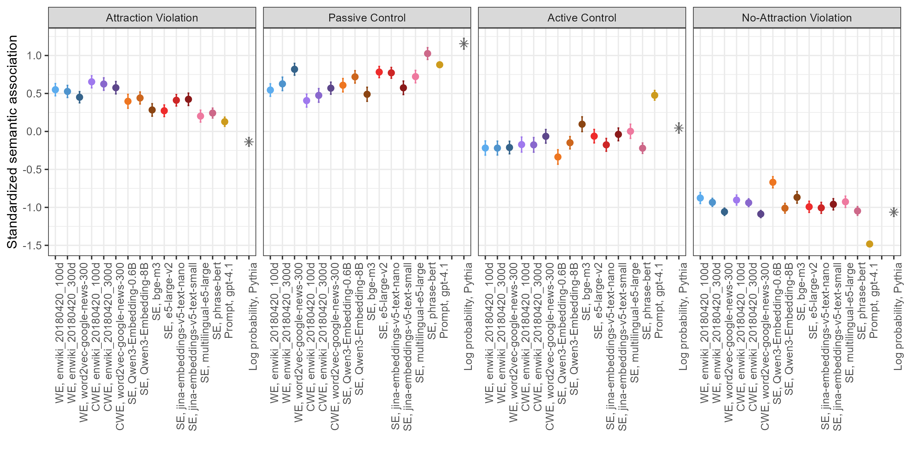
*Figure: Semantic Association, Kim and Osterhout (2005)*

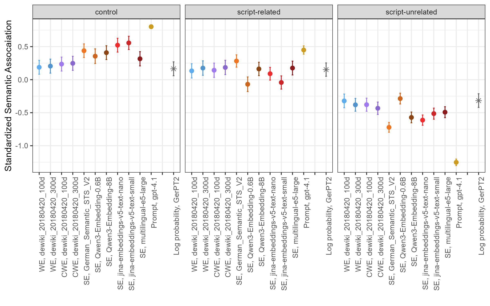
*Figure: Semantic Association, Delogu et al. (2019)*

Semantic association implemented with prompting doesn't follow the same pattern as the embedding-based implementations. 
For the stimuli from Kuperberg et al. (2007), the semantic association of the no violation condition is estimated much higher than the related animacy thematic role violation condition, although these should have similar semantic association. However, the no violation condition is more plausible as there is no violation of animacy (i.e., eggs that eat).
For the stimuli from Kim and Osterhout (2005), we similarly see an influence of plausibility. Especially in the active control condition, which is not really semantically associated to the preceding context, however, the prompt implementation indicates similar levels of semantic association in this condition compared to the attraction violation condition.
Finally, on the data from Delogu et al. (2019) we actually see a pattern similar to the expected recovered by the prompt-based implementation of semantic association.

## Fitting the N400 from Delogu et al. (2019)

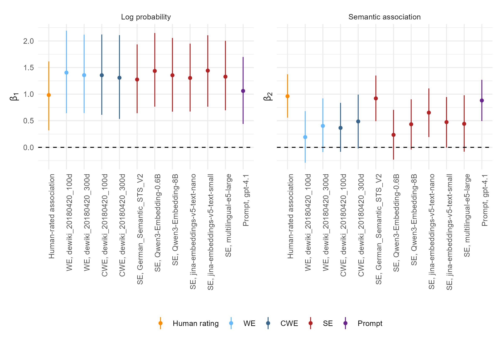
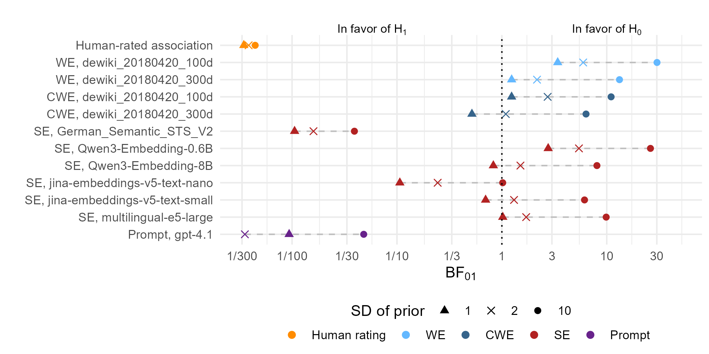

When using the prompt-based implementation of semantic association to predict the N400 from the study by Delogu et al. (2019), we actually see evidence for a positive effect similarly to the results from the regression models with human-rated associations.

This implementation is also the most correlated with the human-rated associations -- more so than the ``German_Semantic_STS_V2`` sentence embedding model.

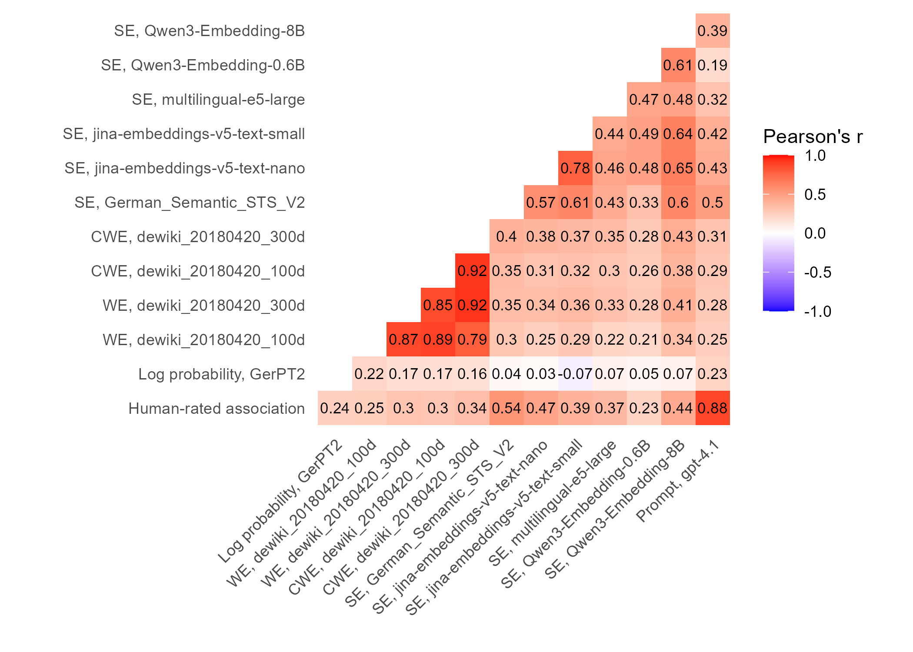

## Fitting the N400 from natural stimuli

### UCL
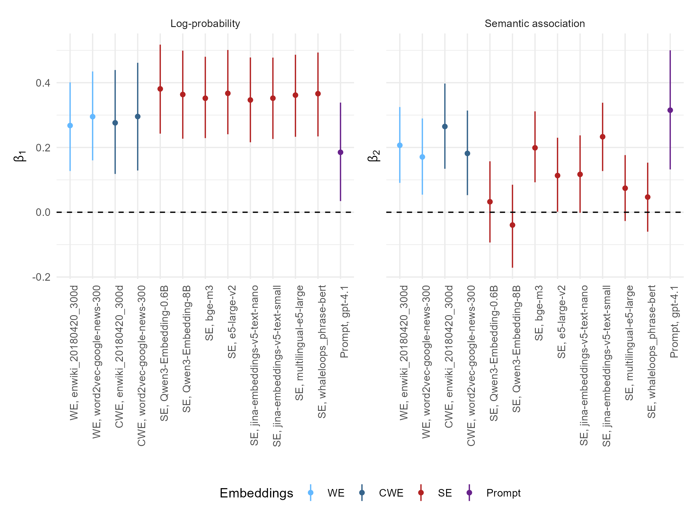
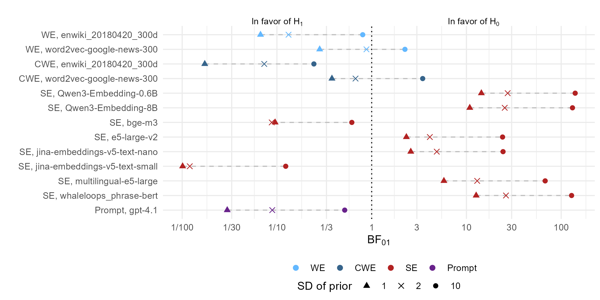

On the UCL corpus, we see an effect of prompt=based semantic association estimated by the regression model. However, the estimated effect of log probability is smaller compared to the models fitted with embedding-based semantic association. While the Bayes factor does indicate evidence in favour of an effect, this doesn't exceed the evidence found when using the ``jina-embeddings-v5-text-small`` sentence embeddings for implementing semantic association.

When looking at the correlations (below), we also see that the prompt-based implementation is very correlated wit log probability.

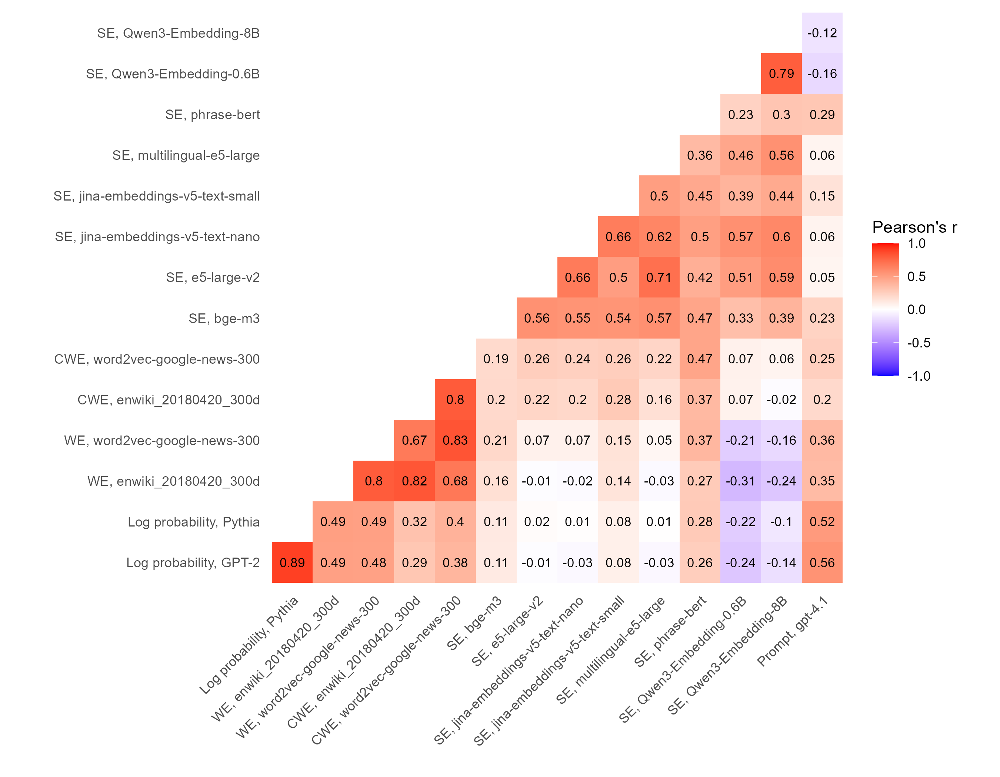

### DERCo
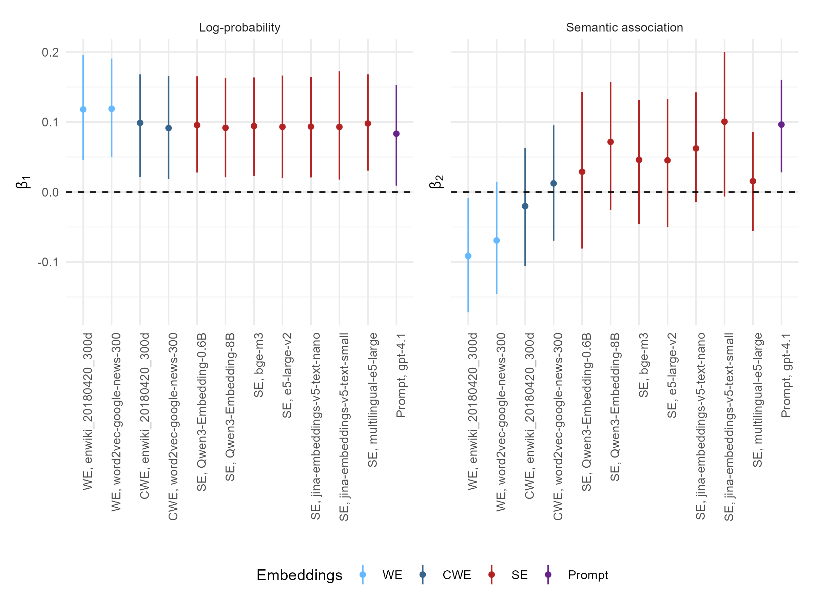
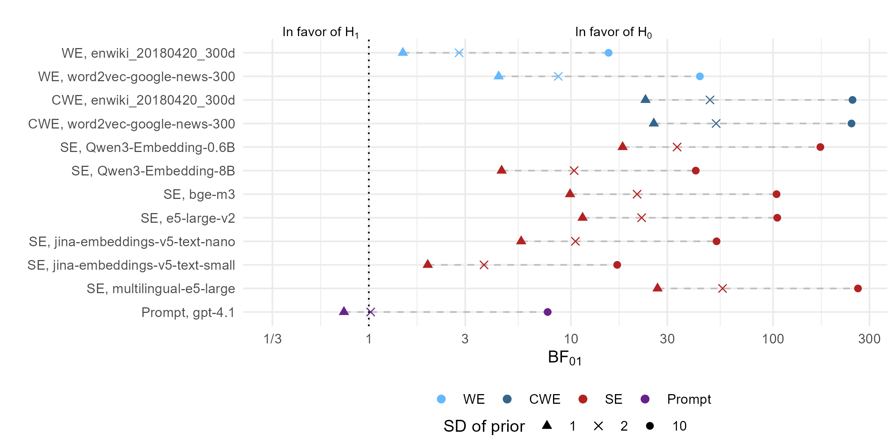

On the DERCo corpus, we still don't find an effect of semantic association.

.png)

### TiNT
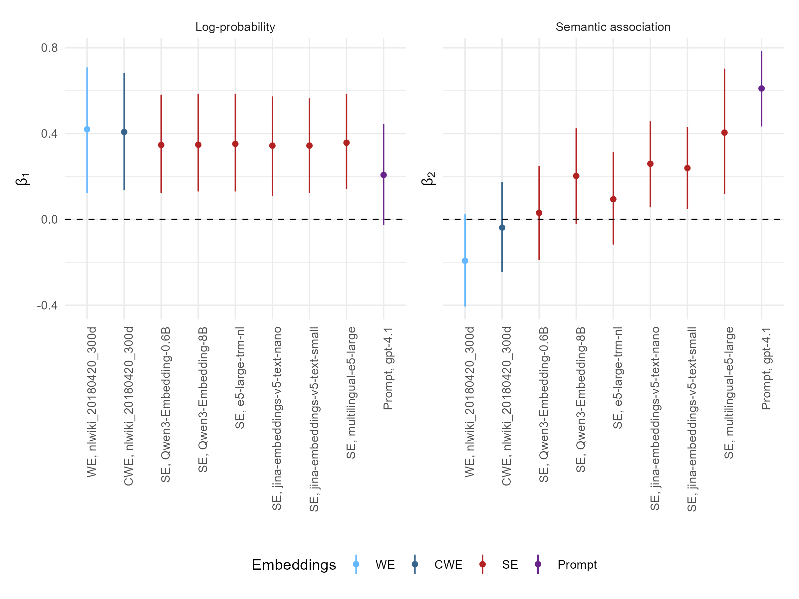
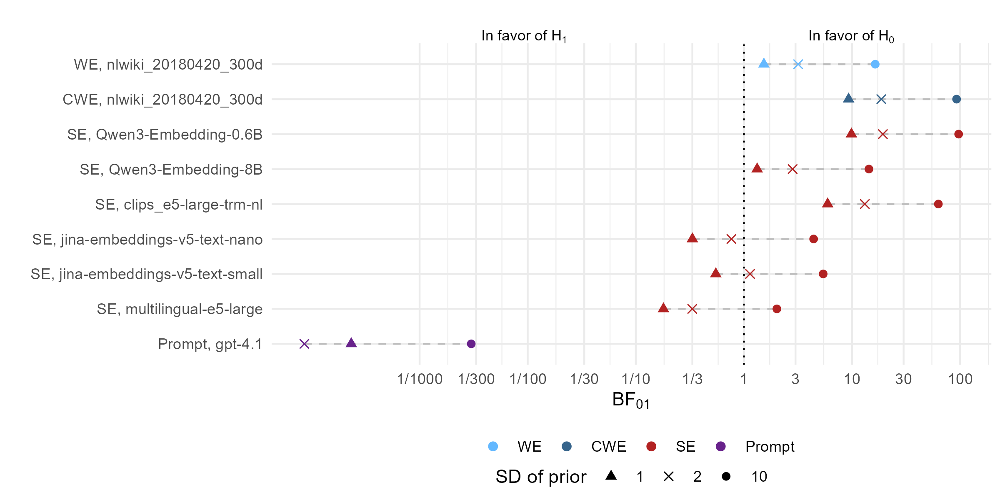

On the TiNT corpus, the estimated coefficient of prompt-based semantic association is larger than any of effects estimated with embedding-based semantic associations. This also results in much stronger evidence in favor of an effect estimated by the Bayes factor. However, similar to on the UCL corpus, the regression coefficient for log probability is smaller -- this could indicate that some of the co-variance between prompt-based semantic association and log probability. However, the Bayes factor analysis still suggests strong evidence for an effect. Moreover, when looking at the correlation between prompt=based semantic association and log probability, this does not exceed the correlation of log probability and the other embedding-based measures.

.png)


## References

- Brysbaert, M., Martínez, G., & Reviriego, P. (2024). Moving beyond word frequency based on tally counting: AI-generated familiarity estimates of words and phrases are an interesting additional index of language knowledge. Behavior Research Methods, 57(1), 28. https://doi.org/10.3758/s13428-024-02561-7
- Delogu, F., Brouwer, H., & Crocker, M. W. (2019). Event-related potentials index lexical retrieval (N400) and integration (P600) during language comprehension. Brain and Cognition, 135, 103569. https://doi.org/10.1016/j.bandc.2019.05.007
- Frank, S. L., Otten, L. J., Galli, G., & Vigliocco, G. (2015). The ERP response to the amount of information conveyed by words in sentences. Brain and Language, 140, 1–11. https://doi.org/10.1016/j.bandl.2014.10.006
- Kim, A., & Osterhout, L. (2005). The independence of combinatory semantic processing: Evidence from event-related potentials. Journal of Memory and Language, 52(2), 205–225. https://doi.org/10.1016/j.jml.2004.10.002
- Kuperberg, G. R., Kreher, D. A., Sitnikova, T., Caplan, D. N., & Holcomb, P. J. (2007). The role of animacy and thematic relationships in processing active English sentences: Evidence from event-related potentials. Brain and Language, 100(3), 223–237. https://doi.org/10.1016/j.bandl.2005.12.006
- Østergaard, S. M., Lichtenberg, L. D., Boon, L., & Nicenboim, B. (2026). A Corpus of Joint EEG and Self-Paced Reading of Natural Dutch Texts. 11260–11271. https://doi.org/10.63317/49tvxys2q4zc
- Quach, B. M., Gurrin, C., & Healy, G. (2024). DERCo: A Dataset for Human Behaviour in Reading Comprehension Using EEG. Scientific Data, 11(1), 1104. https://doi.org/10.1038/s41597-024-03915-8


